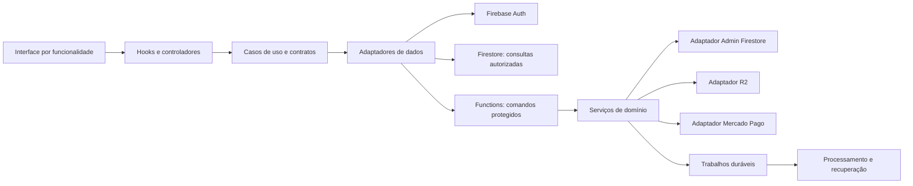

# Arquitetura e padrões de implementação — Folko

Revisão de produto: 2026-11-05. Aplicar a [direção Folko](05-direcao-folko.md): rede social geral de divulgação no Brasil, mantendo os recursos atuais. Texto/foto/vídeo são o destino do feed; não descartar o trabalho técnico validado.

## 1. Diagnóstico baseado no código

Snapshot histórico de 2026-11-01, depois da limpeza. Não descreve necessariamente o código atual: extratos, índices, testes e inventário já evoluíram. Consultar estado.json e o mapa atualizado para os destinos validados:

| Evidência local | Implicação |
|---|---|
| `src/screens/FeedScreen.tsx`: 1.768 linhas; usa `ScrollView` | Player, gestos, montagem de itens e interface estão acoplados |
| `src/screens/ProfileScreen.tsx`: 1.170 linhas | Perfil, configurações e fluxos profissionais precisam de controladores distintos |
| `src/actions/useSocialActions.ts`: 1.145 linhas | Muitas assinaturas e responsabilidades em um único ciclo de vida |
| `src/screens/MessagesScreen.tsx`: 751 linhas | Lista, conversa, filtros, recibos e ações visuais compartilham um arquivo grande |
| `src/services/firebaseSocialService.ts`: 736 linhas | Acesso a vários domínios reunido em um serviço e snapshot global |
| `src/app/AppRoutes.tsx`: 619 linhas; `App.tsx`: 411 | Composição e roteamento propagam numerosas props e setters |
| `functions/src/mercadoPago.ts`: 576 linhas | Há integração de cobrança, não apenas uma simulação |
| Listeners globais de `follows`, `postEngagement` e `postComments` | O custo e a incompletude passam a depender do tamanho total do produto |
| Limites atuais de 5.000 follows, 2.000 métricas, 2.000 comentários e 500 mensagens por direção | Os limites cortam dados; não implementam paginação nem escolhem necessariamente os mais recentes |
| Perfis limitados a 200; feed limitado a 50 | Busca e galerias podem depender de um conjunto parcial e global |
| `firestore.indexes.json` vazio | Os índices necessários não estão declarados no repositório; isso não prova que não existam índices no Console |
| Testes como `firestoreRules.test.mts` e `remoteSync.test.mts` usam regex no fonte | A suíte contém testes úteis, mas parte dela não executa autorização, queries ou comportamento real |
| Estado local versão 6 e chaves legadas `@nextstar/...` | Compatibilidade local precisa de migração, não de remoção direta |
| Exclusão de mídia e documento em serviços diferentes | Não há transação única entre R2 e Firestore; falhas parciais precisam de recuperação |
| `index.ts` do backend contém handlers de mídia e reexports | O ponto de entrada ainda possui implementação de negócio |

O README, `TechnicalDebt.md` e `docs/product-plan.md` contêm descrições de fases antigas. Não usar essas descrições como prova de ausência de autenticação, mídia remota, mensagens ou assinatura.

Antes de mover arquivos, registrar as rotas, exports de Functions, contratos de dados e testes que dependem dos caminhos atuais. Atualizar esses testes sem apagar o comportamento que eles pretendiam proteger.

## 2. Arquitetura escolhida

Um sistema modular com duas unidades de implantação: cliente Expo e backend Functions. Processamento pesado de mídia pode ganhar um worker isolado, após validar necessidade e custo. Separar serviços de negócio em deploys independentes não é um pré-requisito de escala.

Configuração de ambiente fica validada na inicialização e separada de domínio: projeto, região, buckets, URLs e modo do provedor não devem ser espalhados em constantes de negócio. Segredos permanecem no mecanismo apropriado do servidor; somente configuração pública pode usar `EXPO_PUBLIC_*`. Funcionalidade desabilitada não deve exigir o segredo de outra funcionalidade para compilar testes puros.



Regras de dependência:

1. `domain` não importa React, SDK Firebase, R2, UI ou variáveis de ambiente.
2. `application` recebe portas concretas pequenas: `PostRepository`, `MediaGateway`, `Clock`, `IdGenerator`. Não criar uma interface genérica para cada classe.
3. `data` implementa consultas, persistência, transformação de DTOs e integração com SDKs.
4. `ui` e hooks de apresentação chamam casos de uso; não montam caminhos de coleção nem executam cobrança diretamente.
5. Um módulo usa a API pública de outro módulo. Imports profundos e ciclos devem ser detectados na CI.
6. Firebase Admin ignora Security Rules: toda operação privilegiada verifica identidade, autorização e invariantes no backend. [Referência](https://firebase.google.com/docs/firestore/security/rules-query).

## 3. Estrutura final proposta

```text
src/
  app/                         # somente arquivos de rotas, quando N02 for concluída
  bootstrap/                   # composição, providers e inicialização
  navigation/                  # contrato e adaptador de navegação durante a transição
  features/
    auth/
    profiles/
    posts/
    feed/
    follows/
    engagement/
    comments/
    messaging/
    notifications/
    preferences/
    professional/
    billing/
    identity/
    moderation/
  shared/
    ui/                        # somente componentes de uso comprovado em mais de um módulo
    theme/                     # tokens, providers e construção de estilos
    errors/                    # códigos e tradução de erros para apresentação
    primitives/                # utilitários realmente independentes do negócio
  platform/                    # câmera, armazenamento e notificações web/native

functions/src/
  index.ts                     # apenas inicialização e exports públicos estáveis
  bootstrap/
  modules/<dominio>/
    handlers/                  # adapta chamada HTTP/callable/evento
    application/               # autorização e coordenação da operação
    domain/                    # invariantes e políticas puras
    data/                      # Firestore, R2 e provedores
  shared/                      # erros, contexto de requisição, validação e logging
  jobs/                        # execução durável e retomável

contracts/                     # documentação de API e fixtures de compatibilidade
tests/                         # manter inicialmente a suíte Node existente
tests/integration/             # SDK e Emulator Suite
tests/e2e/                     # navegação com dados sintéticos
docs/architecture/             # decisões e modelo operacional atualizado
scripts/migrations/            # ferramentas de migração com dry-run
```

Dentro de um módulo, criar apenas as pastas necessárias. Um utilitário puro pequeno não precisa de quatro camadas. Componentes específicos de uma tela ficam junto dela:

```text
features/feed/ui/FeedScreen/
  FeedScreen.tsx
  FeedScreen.styles.ts
  FeedScreen.types.ts
  components/FeedCaption/
```

Esta proposta substitui a convenção antiga de novas telas em `src/pages`. `F02` deve registrar a decisão e atualizar `TechnicalDebt.md` antes das movimentações. Não manter simultaneamente `pages`, `screens` e `features` como três destinos oficiais.

## 4. Mapa inicial de arquivos

| Origem atual | Destino conceitual |
|---|---|
| `App.tsx` | `bootstrap/AppRoot.tsx`, apenas composição |
| `src/app/AppRoutes.tsx` | adaptadores de navegação; depois rotas pequenas em `src/app` |
| `src/app/useAppNavigation.ts` | `navigation/legacyNavigationAdapter.ts` durante a migração |
| `src/actions/createAppActions.ts` | casos de uso por domínio; remover setters de seus contratos |
| `src/actions/useSocialActions.ts` | hooks de follows, engagement, comments, messaging, notifications e preferences |
| `src/services/firebaseSocialService.ts` | repositórios pequenos dos respectivos módulos |
| `src/services/firebaseProfileService.ts` | `profiles/data` e casos de uso de perfil/username |
| `src/services/firebasePostService.ts`, `r2PostService.ts` | `posts/data`; SDKs atrás de contratos |
| `src/screens/FeedScreen.tsx` | `feed/ui/FeedScreen` e player reutilizável após separar controles de feed |
| `src/screens/ProfileScreen.tsx` | `profiles/ui`, `preferences/ui` e `professional/ui` |
| `src/screens/ProfileDiscoveryScreen.tsx` | `profiles/ui/ProfileDiscoveryScreen` |
| `src/screens/MessagesScreen.tsx` | `messaging/ui/ConversationList` e `ConversationScreen` |
| `src/screens/SubmissionScreen.tsx` | `posts/ui/SubmissionScreen` e adaptadores `platform/media` |
| `src/types.ts` | tipos de cada domínio; fachada temporária de reexports |
| `src/styles/appStyles.ts` | estilos colocados junto dos componentes; fachada temporária |
| `functions/src/mercadoPago.ts` | `modules/billing`; preservar exports de Functions |
| `functions/src/index.ts` | extrair mídia para `modules/posts`; manter nomes públicos |
| `src/repositories/*`, `src/services/*Storage.ts` | cache, rascunhos e adaptadores versionados por usuário |

Após cada movimentação, atualizar `docs/architecture/mapa-arquivos.md` com o caminho de origem, destino e fachada ainda existente. Os caminhos das fichas refletem a base observada; consultar esse mapa quando um pré-requisito já tiver movido o arquivo.

## 5. Tipos, identidade e contratos

- `AuthUid` identifica a conta; `PostId` identifica uma publicação; `ConversationId` identifica uma conversa. Não usar a mesma string genérica para três domínios.
- `Player` hoje é principalmente um modelo de apresentação de uma publicação com dados de autor. O destino é `FeedItem`, composto de `Post`, resumo público de autor e métricas. Não transformar uma pessoa em uma publicação.
- `VideoSubmission` mistura foto/vídeo, publicação e revisão. O requisito novo de texto exige uma união de tipos e mídia opcional por tipo em P04, sem gerar mídia fictícia. Separar `Post`, `MediaAsset`, `UploadDraft` e `ModerationDecision` mantendo adaptadores para a forma antiga.
- Prefixos `profile-` e `approved-` pertencem à compatibilidade. Não gravá-los como novos identificadores canônicos e não removê-los com substituição textual indiscriminada.
- Não migrar IDs antes de construir e verificar um mapa de correspondências. Não somar curtidas duplicadas sem deduplicar por usuário e publicação.
- DTO Firestore usa `Timestamp` e validação na fronteira. Domínio usa instantes UTC explícitos; cursor preserva a precisão do timestamp original e o ID do documento.
- Valores financeiros usam centavos inteiros no domínio. Conversão para o formato do provedor fica no adaptador, com testes. Não reinterpretar silenciosamente os `amount`/`budget` existentes.
- Códigos de estado internos em inglês; rótulos traduzidos na interface. Um adaptador deve continuar entendendo os estados portugueses dos dados locais legados.
- Dados desconhecidos não viram permissões ou zeros silenciosamente. Rejeitar/quarentenar com diagnóstico ou representar estado desconhecido.

Manter contratos versionados dos callables existentes, incluindo `createMediaUpload`, `finalizeMediaUpload`, `deleteR2Post`, `setPostLike`, `recordPostView`, `sendDirectMessage`, recibos, notificações, avatar, conta e assinatura. Um refactor de arquivo não muda nome de função implantada, região, método, formato de payload ou semântica de idempotência.

Compartilhamento de código entre frontend e Functions é uma decisão posterior de empacotamento. Inicialmente, compartilhar contratos documentados e fixtures, com validação autoritativa no servidor. Não adicionar `workspace:*` ao backend sem provar que seu pacote de deploy contém o código compilado e as dependências necessárias fora do monorepo.

## 6. Estado e ciclo de vida

| Estado | Autoridade |
|---|---|
| Credenciais e sessão | Firebase Auth |
| Perfil, posts, relações, mensagens e assinaturas | Backend/Firestore, conforme a política de cada operação |
| Resumo de perfil, métricas, lista de conversas e selo | Projeções derivadas, reconstruíveis |
| Modal aberto, campo de pesquisa e progresso visual | Estado local da interface |
| Rascunho, preferências do dispositivo e cache | Armazenamento local versionado e isolado por UID |

Usar React Context pequeno por responsabilidade e hooks de funcionalidade. Não introduzir Redux, Zustand e outro cache de queries ao mesmo tempo. Uma biblioteca de estado/cache só entra com problema mensurado e uma decisão que explique como ela se relaciona com o cache do SDK Firestore.

Toda assinatura devolve cancelamento. Na troca de conta, desmontar assinaturas anteriores e invalidar resultados pendentes por geração/UID. A resposta atrasada do usuário A não pode preencher a tela do usuário B. Paginação, uploads, câmera e player precisam de testes de desmontagem e erro.

Não disparar notificações, chamadas externas ou mudanças de estado React dentro do corpo de renderização. A mudança de tema global feita durante renderização deve ser substituída por uma composição previsível de contexto e estilos.

## 7. Norma de Clean Code adotada

1. Uma função tem um resultado identificável. Separar validação, regra de negócio e efeitos quando a mistura impede testar ou entender o fluxo.
2. Preferir nomes do produto: `publishPost`, `getConversationPage`, `applySubscriptionSnapshot`. Evitar `handleData`, `manager`, `helper2` e serviços que conhecem todos os domínios.
3. Dependências externas entram por construtor/factory/parâmetro na fronteira do caso de uso. Não usar service locator global dentro de regra pura.
4. Usar TypeScript estrito; entrada externa é `unknown` até ser validada. Evitar `any`, casts para silenciar erro e propriedades opcionais que representem estados impossíveis.
5. Usar uniões discriminadas para carregamento, falha, sucesso e operações de upload. Diferenciar `loading`, vazio e erro; uma lista vazia não significa falha de sincronização.
6. Não capturar erro e retornar sucesso fictício. Mapear erros esperados para códigos estáveis; registrar falhas inesperadas com contexto sanitizado.
7. Extrair componente quando houver responsabilidade visual própria, reutilização real ou necessidade de teste isolado. Não fragmentar todo bloco JSX em um arquivo.
8. Colocar estilos e tipos locais junto do componente. `shared` não é depósito de código sem dono.
9. Tratar tamanho e complexidade como alertas de revisão: investigar componentes acima de aproximadamente 250–300 linhas e funções com muitas ramificações. Não dividir funções apenas para satisfazer uma contagem.
10. Introduzir lint e formatação de maneira incremental, mantendo um orçamento de dívida existente. Não produzir reformatação global junto de mudança comportamental.
11. Manter uma única política de data, ID, erro e autorização por domínio. O cliente pode orientar UX; o servidor continua validando a operação.
12. Comentários explicam decisões e invariantes. Não narrar operações óbvias nem deixar TODO sem tarefa, contexto e condição de remoção.

## 8. Navegação e apresentação

Primeiro definir intenções de navegação tipadas e adaptá-las ao roteamento manual. Depois instalar Expo Router em versão compatível com o SDK confirmado, sem atualizar Expo/RN no mesmo trabalho. A documentação de instalação deve ser conferida na versão correspondente; páginas atuais podem redirecionar para versões mais novas. [Documentação oficial](https://docs.expo.dev/router/introduction/).

Rotas propostas: autenticação, onboarding, abas principais, `/u/[username]`, `/post/[postId]`, `/messages/[conversationId]` e área administrativa protegida. Resolver username para UID; não colocar dados privados nem autorizações em parâmetros de URL.

Antes de ativar Router, mover a composição atual de `src/app` para `bootstrap`/`navigation`. Cada rota nova deve ser apenas uma entrada para uma funcionalidade. Validar histórico web, botão voltar Android, restauração de sessão e links de notificações.

Extrair o player antes de virtualizar o feed. O componente compartilhado conhece reprodução, buffering e eventos; a tela decide item ativo, gestos, overlays e política de autoplay. `FlatList` exige chaves estáveis e cuidado com o estado de itens que saem da janela. [Referência](https://reactnative.dev/docs/flatlist).

## 9. Decisões que não devem ser tomadas automaticamente

Mudança de provedor de banco, exposição anônima de perfis/mídia, nova política de moderação, retenção de dados pessoais, alteração de preço/plano, remoção de suporte a clientes antigos, exigência de App Check para plataformas ainda não preparadas e atualização de SDK principal exigem uma decisão específica. Preparar evidências e opções; não misturar essas decisões em uma extração de componente.

## 10. Exemplo de fronteira para orientar o executor

Usar este exemplo como desenho do contrato, não como um pacote para copiar sem adaptar. O `FeedItem` vem do domínio e não carrega `DocumentSnapshot`, objetos do SDK nem setters React.

```ts
type PageRequest = { limit: number; cursor?: string };
type Page<T> = { items: T[]; nextCursor: string | null; hasMore: boolean };
type Unsubscribe = () => void;

interface FeedRepository {
  getPage(request: PageRequest): Promise<Page<FeedItem>>;
  subscribeRecent(
    limit: number,
    onPage: (page: Page<FeedItem>) => void,
    onError: (error: AppError) => void
  ): Unsubscribe;
}
```

A identidade autenticada entra na composição do adaptador/contexto de operação; nunca é concedida porque o cliente passou um UID em um objeto. No servidor, o token é verificado novamente.

Arquivos concretos sugeridos para essa fatia:

```text
src/features/feed/domain/FeedItem.ts
src/features/feed/application/FeedRepository.ts
src/features/feed/data/createFirestoreFeedRepository.ts
src/features/feed/ui/useFeedController.ts
src/features/feed/ui/FeedScreen/FeedScreen.tsx
```

Fluxo: a tela dispara intenção de carregar mais; o hook coordena loading/erro e descarte de resposta antiga; o caso de uso/repositório produz a próxima página; o adaptador aplica filtros, cursor e transformação de documentos. O SDK não vaza para a assinatura pública.

Invariantes do contrato: cursor é opaco e validado pelo adaptador; `hasMore=false` exige `nextCursor=null`; continuação observada usa a política de lookahead e concorrência descrita no modelo de dados; documento não autorizado não pode ser filtrado apenas depois de chegar à UI; fim da lista, falha e lista inicialmente vazia são estados diferentes.

Não usar `subscribeRecent` para reassinar todas as páginas. A semântica de eventos da janela recente deve dizer quais itens mudaram/removeram, mantendo páginas históricas e deduplicação por ID no controlador. O exemplo não elimina essa decisão nem transforma uma alteração de janela em exclusão do post.

Provas de comportamento para essa fatia:

| Dado/quando | Resultado esperado |
|---|---|
| 45 posts válidos e páginas de 20 | 20 + 20 + 5, sem IDs perdidos ou duplicados |
| Vários posts com a mesma data | Ordem e cursor usam desempate estável |
| Um post novo chega durante a leitura do histórico | Janela recente atualiza sem duplicar o histórico |
| O usuário troca de conta durante a requisição | Resposta da conta anterior é descartada |
| Documento legado sem campo novo | Adaptador segue a compatibilidade decidida ou emite diagnóstico, sem inventar dados |
| SDK nega acesso ou fica indisponível | Erro explícito e retry seguro, sem apresentar sucesso/lista vazia fictícios |

Começar com factories e funções simples. Classes, contêiner de injeção, um framework de eventos ou uma base genérica de repositórios não são requisitos de Clean Code.
